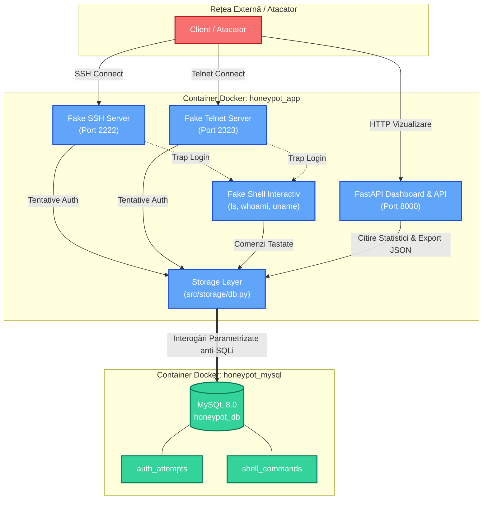

# SSH & Telnet Honeypot - System Design & Architecture Document

## 1. Prezentare Generală
Acest proiect implementează un serviciu honeypot de tip "medium-interaction" pentru protocoalele **SSH** și **Telnet**, având ca scop atragerea, capturarea și analiza încercărilor de atac prin forță brută și comenzi neautorizate într-un mediu izolat și controlat.

Sistemul este proiectat să ruleze exclusiv în containere Docker pe o rețea internă dedicată (`honeypot_net`), protejând mediul gazdă.

---

## 2. Arhitectura Sistemului

Sistemul este format din două containere principale:
1. **`honeypot_mysql`**: Container oficial MySQL 8.0, utilizat pentru persistența datelor de atac și a comenzilor din sesiuni, izolat cu volum persistent (`mysql_data`).
2. **`honeypot_app`**: Container Python 3.12 bazat pe user non-root (`appuser`), care găzduiește:
   - Serverul fals SSH (`asyncssh`) pe portul `2222`
   - Serverul fals Telnet (`asyncio`) pe portul `2323`
   - Shell-ul fals interactiv (sandbox în memorie)
   - Aplicația FastAPI (`src.web.app`) cu Dashboard-ul HTML/CSS și API-ul de Export JSON pe portul `8000`

### Diagrama Componentelor

---

## 3. Schema Bazei de Date (MySQL)

Baza de date `honeypot_db` este inițializată automat la pornire din fișierul `db/init.sql`.

### Tabel: `auth_attempts`
Înregistrează fiecare încercare de autentificare de pe protocoalele SSH sau Telnet.
| Coloană | Tip Date | Constrângeri | Descriere |
| :--- | :--- | :--- | :--- |
| `id` | INT | AUTO_INCREMENT, PRIMARY KEY | Identificator unic |
| `timestamp` | DATETIME | DEFAULT CURRENT_TIMESTAMP | Data și ora tentativei (UTC) |
| `protocol` | VARCHAR(10) | NOT NULL | Protocolul utilizat (`SSH` sau `TELNET`) |
| `source_ip` | VARCHAR(45) | NOT NULL | Adresa IP a atacatorului |
| `source_port` | INT | NOT NULL | Portul sursă al conexiunii |
| `username` | VARCHAR(255) | NOT NULL | Numele de utilizator încercat |
| `password` | VARCHAR(255) | NOT NULL | Parola încercată |
| `status` | VARCHAR(30) | DEFAULT 'REJECTED' | Stare login (`REJECTED` sau `ACCEPTED`) |

### Tabel: `shell_commands`
Înregistrează fiecare comandă executată de un atacator prins în shell-ul fals.
| Coloană | Tip Date | Constrângeri | Descriere |
| :--- | :--- | :--- | :--- |
| `id` | INT | AUTO_INCREMENT, PRIMARY KEY | Identificator unic |
| `session_id` | VARCHAR(64) | NOT NULL | Hash/UUID unic al sesiunii curente |
| `timestamp` | DATETIME | DEFAULT CURRENT_TIMESTAMP | Data și ora comenzii (UTC) |
| `source_ip` | VARCHAR(45) | NOT NULL | Adresa IP a atacatorului |
| `command` | TEXT | NOT NULL | Comanda exactă tastată în consolă |

---

## 4. Modelul de Securitate & Hardening (Bug Bounty Ready)

1. **Prevenire SQL Injection (SQLi)**:
   - Toate interogările din `src/storage/db.py` folosesc exclusiv **query-uri parametrizate** (`%s` prin driverul `mysql-connector-python`). Nu se folosește concatenare directă de string-uri în instrucțiuni SQL.
2. **Prevenire Stored Cross-Site Scripting (XSS)**:
   - Dashboard-ul folosește motorul Jinja2 cu auto-escaping activat implicit. Orice payload injectat în câmpurile de username/parolă/comandă (ex: ``) este convertit în entități HTML inofensive (`&lt;script&gt;`).
3. **Izolare Fake Shell**:
   - Shell-ul este un mediu emulat în memorie. Nu se execută nicio comandă pe sistemul gazdă sau pe container (sunt interzise apelurile `os.system`, `subprocess` sau `eval`).
4. **Izolare Container & Rulare Non-Root**:
   - Containerul de aplicație rulează cu utilizatorul `appuser` (UID 1000), eliminând riscul de privilege escalation pe sistemul gazdă în eventualitatea unei vulnerabilități de securitate în container.